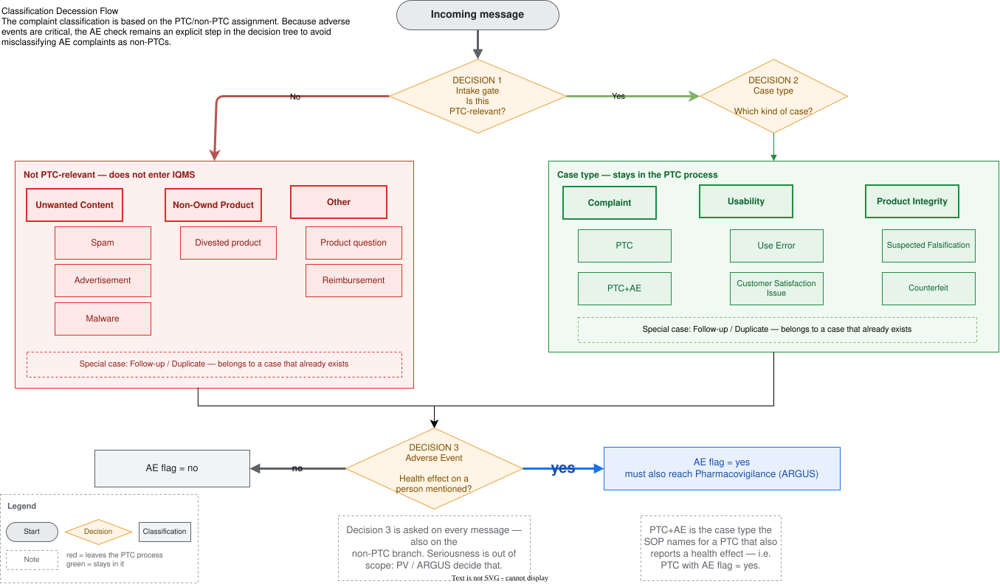

# How to fill in a classification decision card

A guide for Complaint Managers. Read this once, then fill one
[decision card](classification-decision-card.md) per category you were assigned.
A [filled example](classification-decision-card.example.md) shows the expected level of detail.

## Why we ask you to do this

You already decide every day what kind of message you have in front of you. Most of that
knowledge is experience, not written rules. We want to write it down so that a colleague —
or an automated pre-check — reaches the same answer you would.

The Complaint Manager stays the decision authority. The goal is a reliable **proposal with a
visible rationale**, never an autonomous decision (SOP 1937: GenAI does not make GxP decisions
on its own).

## The three decisions

Every incoming message passes three decisions, in this order:



Decision 3 is made **even when** decision 1 says "not a PTC". A pure adverse event report does
not enter IQMS, but it still has to reach Pharmacovigilance.

Your card describes **one** result of **one** of these decisions. Name both in section 1.

## Three points where intuition differs from the SOPs

Please check these before you write. They are the most common sources of a card that looks
right but does not match the process.

| Common assumption | What the SOPs say |
| --- | --- |
| Adverse events are a kind of complaint, split into serious / non-serious | A pure AE is **not a PTC** (SSC-PTC-SOP-001 §5.2.1.1) and does not enter IQMS — it goes to PV. Seriousness is assessed by PV in ARGUS, not by you. For us, AE is a **yes/no flag**. |
| Complaints are grouped by defect: packaging, labeling, missing parts, device defect | That is the `Defect Category` field, set **after** the investigation. At intake it is usually not yet decidable. |
| Classification starts with "which complaint type is it?" | It starts one step earlier: **is this a PTC at all?** Spam, advertisements, product questions, stability, reimbursement and divested-product inquiries must never reach IQMS (URS REQ-021/023). |

Out of scope, so please do not describe them: Initial Risk Classification (High/Medium/Low)
and Defect Category.

## Rules for writing the card

- Describe what you **observe in the message**, not what you conclude after an investigation.
- Write criteria a colleague could apply **without asking you**.
- Prefer concrete wording over abstract rules: "sender domain is a company, not a person"
  beats "looks commercial".
- If you cannot give a rule, give an example. An example beats a vague rule.
- Say **how the criteria combine** (sections 4 and 5). A list alone does not tell us whether
  all criteria are required or only some.
- If you do not know, write it under **Open questions** (section 13). An honest gap is more
  valuable than a guess — it tells us where a human must decide.
- Anonymize all examples: no patient names, no reporter names, no addresses. Product, batch
  and wording may stay.

## Section-by-section notes

Only the sections that are regularly misunderstood are listed here. The others are
self-explanatory.

**3 — SOP basis.** If the rule is your own practice and not written anywhere, say so plainly.
That is not a problem, but it must be visible: an unwritten rule cannot be validated the same
way a written one can.

**4 — Decide YES if.** Mark each line `[REQUIRED]` (if absent, it cannot be this category) or
`[SUPPORTING]` (points this way, but not sufficient alone). Then state the combination rule,
e.g. "all `[REQUIRED]` plus at least two `[SUPPORTING]`". Aim for 3–8 lines.

**5 — Decide NO if.** Any single line here must be enough to rule the category out, even if
everything in section 4 is met. If that is not true for a line, move it to section 4 as
`[SUPPORTING]`, or to section 9.

**6 — Signal phrases.** Write the actual wording you look for, in the original language.
Original-language phrases are especially useful.

**8 — How is the decision made.** Call it a hard rule only if the IF … THEN … sentence holds
on its own, using the `[REQUIRED]` criteria joined with AND. Otherwise write `judgement`.

**9 — When must a human decide.** This section directly shapes the solution. Everything you
list here becomes a mandatory human review in the automated process.

**11 — Examples.** The most valuable part of the card. Give a clear YES, a clear NO that looks
like a YES, and one borderline case. For the borderline case, say what made it hard and
whether you are still unsure — that is exactly where automation must hand over to a human.

## If you have several cards and little time

Fill them in this order:

1. The non-PTC categories — highest volume, clearest benefit.
2. Follow-up / duplicate detection — today purely experience-based (URS REQ-008).
3. Use Error vs. Customer Satisfaction Issue — the SOP definition is abstract.
4. Suspected falsification / counterfeit — URS REQ-056 contains **no criteria at all**;
   whatever you write is the first written basis.

## Where to save, and what happens next

One file per category:

```text
docs/01-current-process/sources/classification-card-<category>.md
```

Use the category in lower case with hyphens, e.g. `classification-card-advertisement.md`.

The criteria then feed the classification prompt
([prompts-classification/](../05-design-spec/prompts-classification/README.md)). If your card
introduces a new term, it is added to the glossary in `docs/02-requirements/`.

Two things we still need outside the cards, if you can supply them: the pick-list values that
exist in IQMS but in no document (`Feedback Type`, `Report Source`, `Product Type`,
`Error codes`), and whether classification itself differs by country or only the routing
afterwards.
